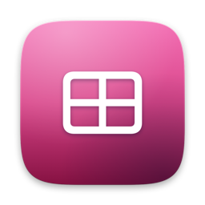
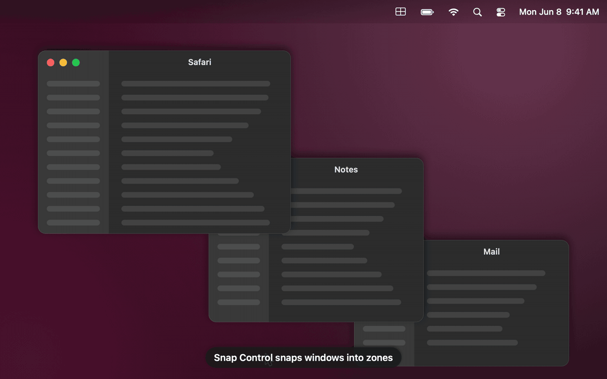
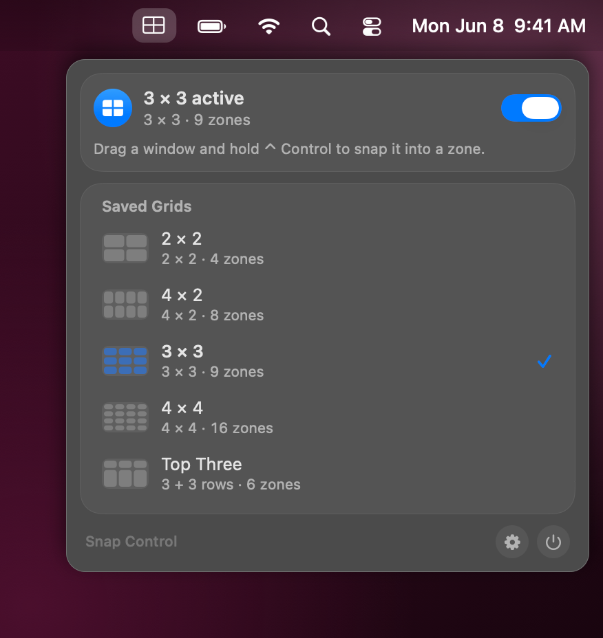
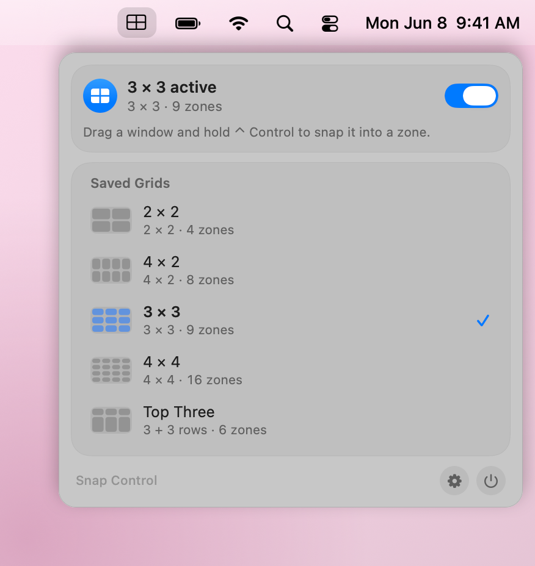
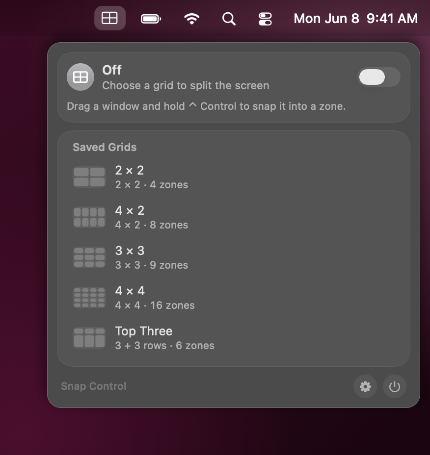
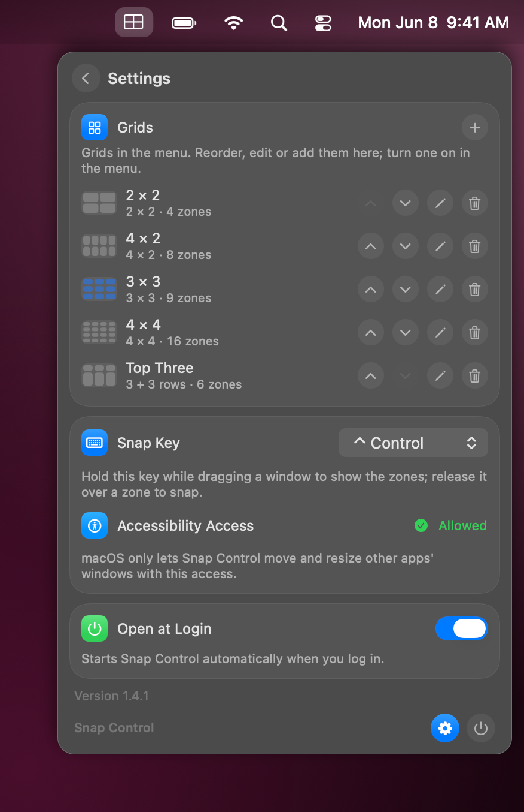
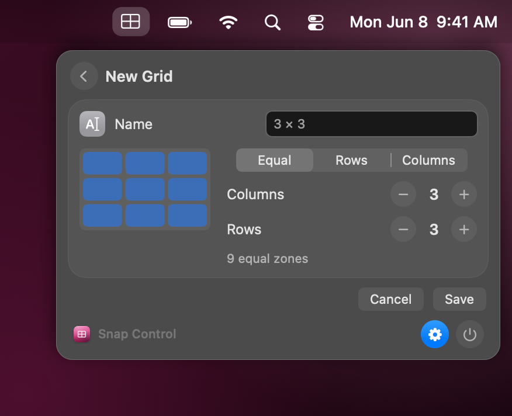
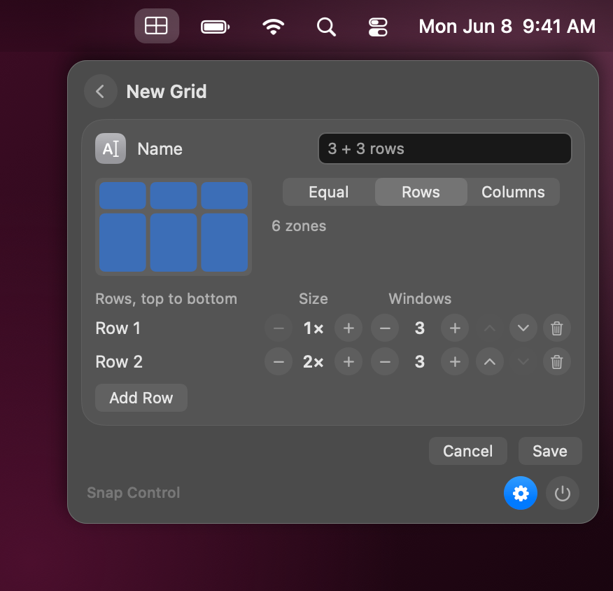

<p align="center">
  
</p>

<h1 align="center">Snap Control</h1>

<p align="center">A menu bar app that splits your display into zones and snaps dragged windows into them.</p>

<p align="center">
  <a href="#requirements"></a>
  <a href="docs/DEVELOPMENT.md"></a>
  <a href="LICENSE"></a>
  <a href="#ai-assisted-development"></a>
</p>

> [!NOTE]
> This app was developed with AI assistance. See [AI-assisted development](#ai-assisted-development).

## In action

### Snapping windows

<p align="center">
  
</p>

Pick a grid in the menu, hold Control while dragging a window and release it over a zone. Switch from 2 × 2 to 3 × 3 at any time; the zones follow the active grid.

<sub>The animations are rendered by the app itself from invented demo data; nothing on your Mac is recorded.</sub>

## Features

- **Saved grids**: named sets; defaults are 2 × 2, 4 × 2, 3 × 3 and 4 × 4, each with 1–8 columns and rows.
- **Custom layouts**: instead of an equal grid, split into rows (top to bottom) or columns (left to right). Each strip has a size (1×–4×, its share of the height or width) and 1–8 windows, up to 6 strips. Example: 3 small windows on top and 3 large ones below.
- **Snap by dragging**: drag a window and hold the key, and all zones of the active grid appear in the accent color with the zone under the pointer highlighted. Release the mouse and the window fills exactly that zone (per display, excluding menu bar and Dock).
- **Your key**: Control (default), Option, Command or Shift.
- **No clash with macOS**: while a grid is active, the built-in macOS window snapping is switched off, because it intercepts the Option key. The previous values are saved and restored when you switch the grid off or quit.

## Screenshots

<p align="center">
  
  
</p>

<table>
  <tr>
    <td align="center"><br>Grid off: snapping paused, saved grids kept</td>
    <td align="center"><br>Settings: grid list, snap key, Accessibility, login</td>
  </tr>
  <tr>
    <td align="center"><br>Editor: equal grid with columns and rows</td>
    <td align="center"><br>Editor: custom layout with rows of different height</td>
  </tr>
</table>

## Requirements

- macOS 26 or later on Apple silicon

## Installation

1. Download `SnapControl-<version>.zip` from the [latest release](../../releases/latest) and unzip it.
2. Move **SnapControl.app** to `/Applications`.
3. Open it. The app is free and ad-hoc signed, not notarized by Apple, so macOS blocks the first launch:
   open **System Settings → Privacy & Security**, scroll down and click **Open Anyway**.
   Alternatively, in Terminal: `xattr -dr com.apple.quarantine /Applications/SnapControl.app`
4. Grant **Accessibility** access when asked (or in Settings → Accessibility), see [Permissions and privacy](#permissions-and-privacy). Without it the app runs but cannot snap.

The app starts at login by default; switch this off under Settings (gear icon) → **Open at Login**.
To uninstall, switch the active grid off (this restores the macOS snapping values), quit the app from the menu and move it to the Trash. You can remove its entry under System Settings → Privacy & Security → Accessibility.

## Usage

- Click the menu bar item and pick a grid from **Saved Grids** to activate it; click the active grid again to switch it off.
- With a grid active, drag a window, hold the snap key (Control by default), move the pointer over a zone and release the mouse.
- Settings (gear icon): edit, reorder and add grids, choose the snap key, check the Accessibility permission and **Open at Login**.

## Build from source

```sh
brew install xcodegen
git clone https://github.com/ape97/SnapControl.git && cd SnapControl
./scripts/check.sh    # build + snapshots + self-test -> RESULT: GREEN
./scripts/deploy.sh   # check, install to /Applications, restart
```

No Apple developer account is needed. Project layout, scripts, signing, screenshots and releases are described in
[docs/DEVELOPMENT.md](docs/DEVELOPMENT.md).

## Permissions and privacy

- **Accessibility** (System Settings → Privacy & Security → Accessibility). Moving and resizing the windows of other apps
  is only possible through the Accessibility API, so macOS requires this permission. The app uses it to find the window
  under the pointer while you drag and to set that window's position and size. It does not read window contents, titles
  or keystrokes. While a grid is active it observes mouse button and modifier-key events (to detect the drag and the snap
  key), nothing else. Without the permission the app runs but cannot snap.
- **macOS snapping values.** While a grid is active, the app switches off three keys of the `com.apple.WindowManager`
  preferences (edge-drag tiling and the Option accelerator) and restarts the WindowManager service with `launchctl`. The
  original values are restored when the grid is switched off or the app quits. No administrator rights are needed.

Everything stays on your Mac: no network access, no telemetry. The only stored data are your grids, the chosen key and a
backup of the macOS snapping values in the app's user defaults.

## AI-assisted development

Snap Control was built with the help of an AI coding assistant: code, comments, documentation and the screenshot
pipeline were written in collaboration with AI. Every change is built and checked with `scripts/check.sh`
(warning-free build, snapshots, self-test, performance test) and the app is in daily use on the maintainer's Mac.
Issues and pull requests are welcome.

## License

MIT, see [LICENSE](LICENSE).
